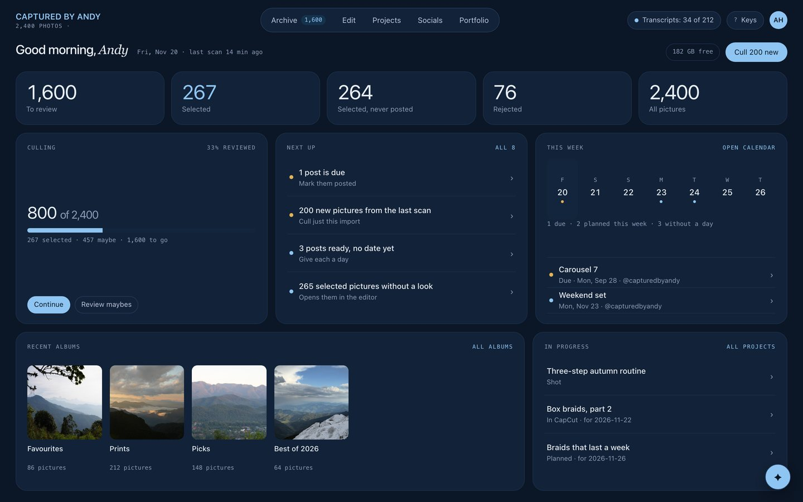
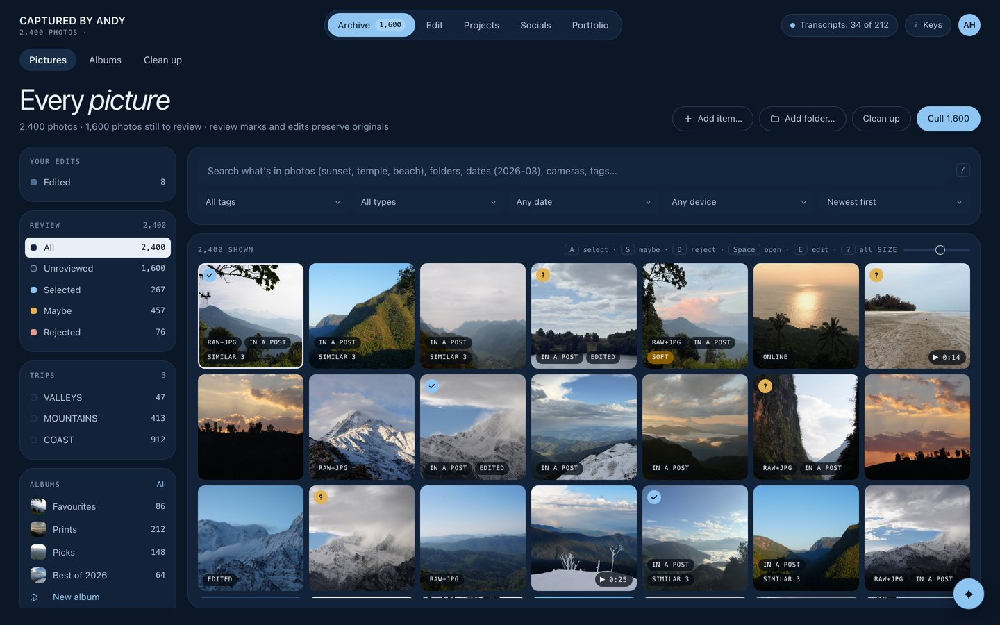
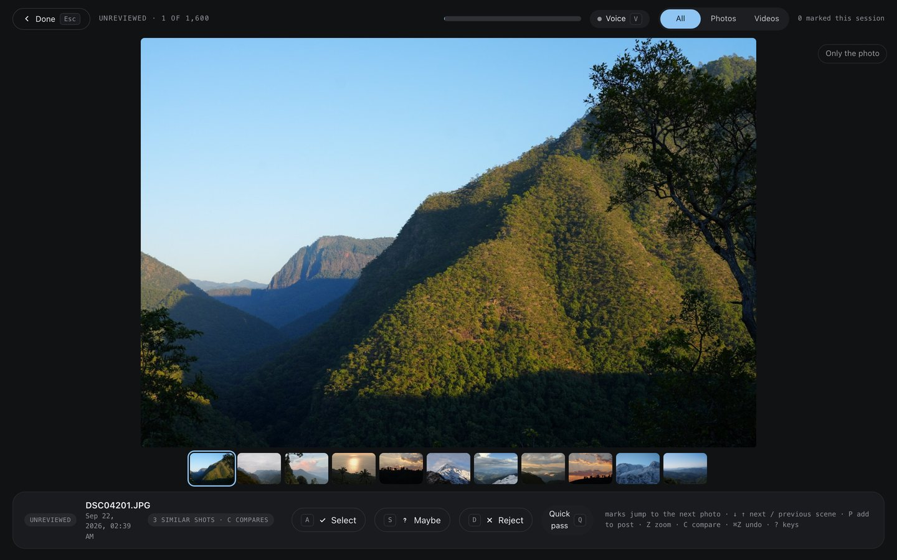
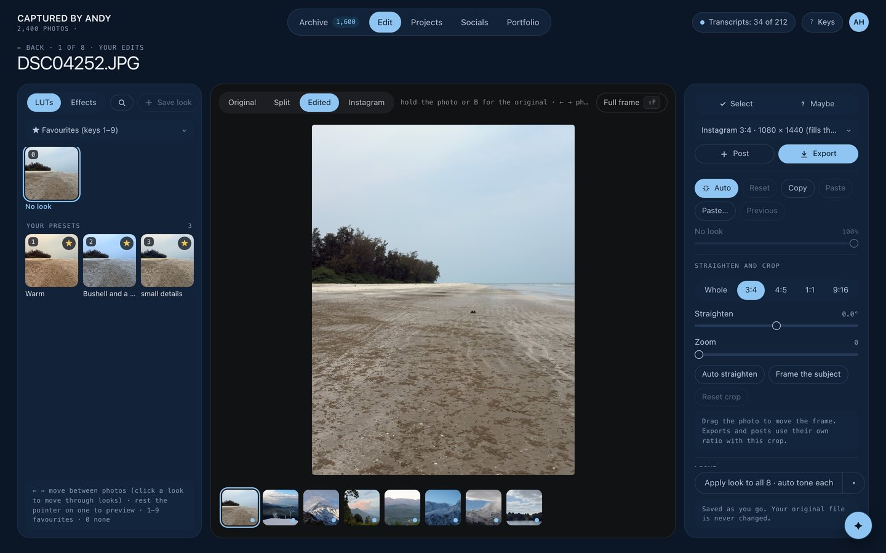
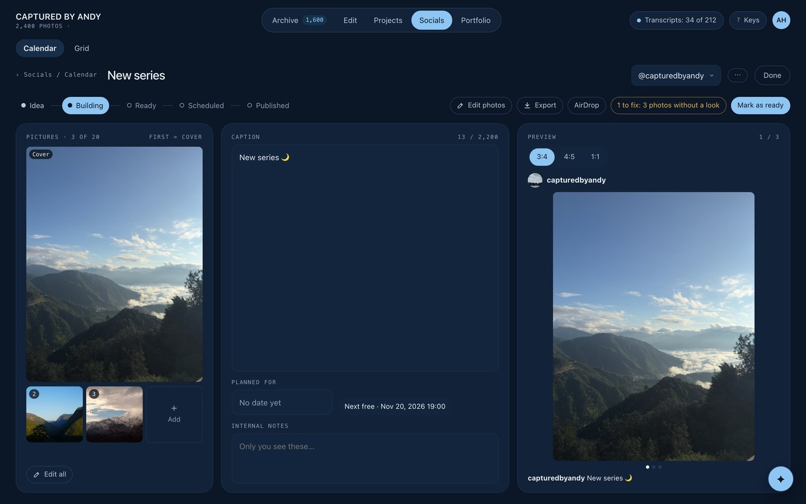
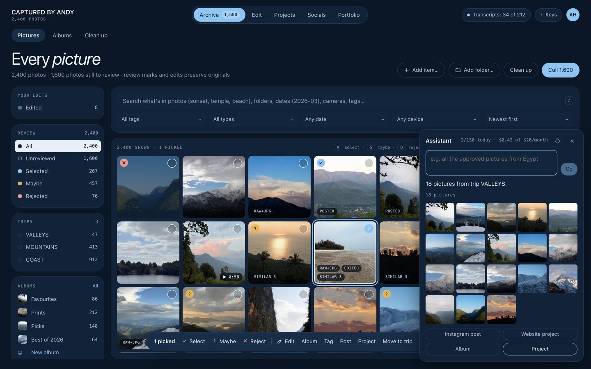
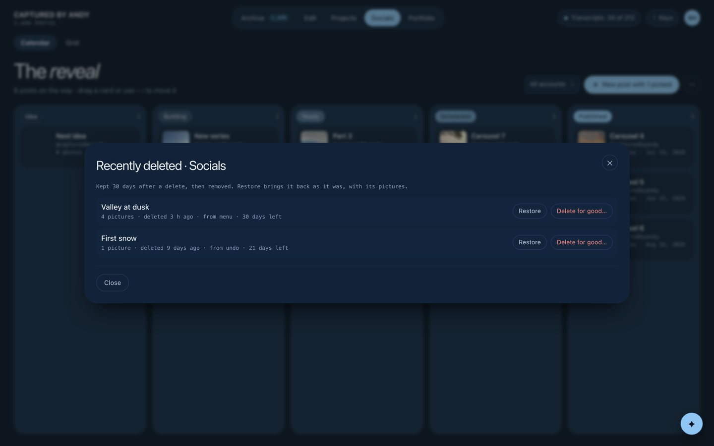
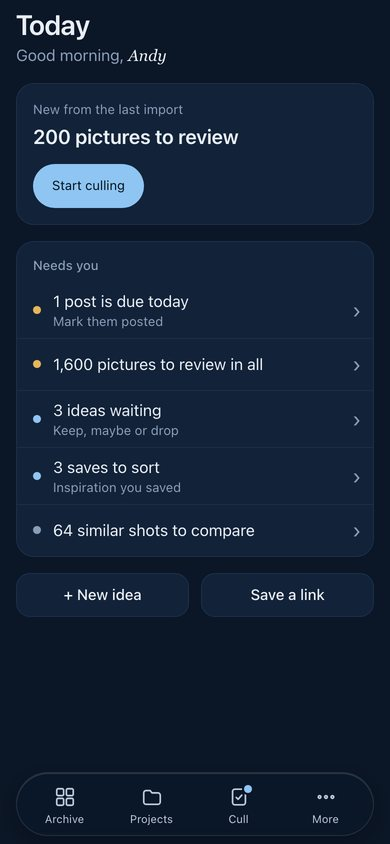
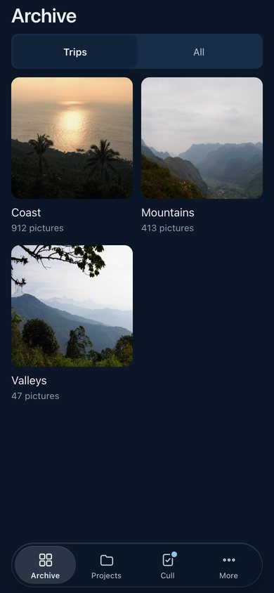
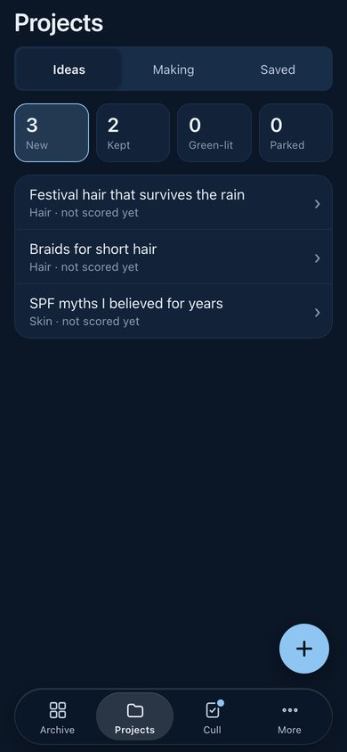

# Captured by Andy

A photo and video studio app a photographer built for his own work: a Mac app that holds a 20,000-file archive without moving a single original, with a phone companion in the browser.

> A clean snapshot of a private repository, shared for review.



## What it does

- **Today:** the day at a glance: what's left to review, what's ready to post, this week's plan, albums and projects in progress.
- **Archive:** the library. Culling (keep / maybe / reject) by keyboard or by voice, trips, albums, tags, search, and Clean up for files that went missing.
- **Edit:** looks and adjustments on top of the original, then exports at the size and quality a platform needs. The original file is never changed.
- **Projects:** an idea from the first note to the finished piece: saved inspiration, scored ideas, production steps, pillars and a roadmap.
- **Socials:** the Instagram feed planned as a board and a calendar (Idea → Building → Ready → Scheduled → Published), with a live preview of each post and its grid tile.
- **Assistant (⌘K):** finds and narrows pictures in plain words (English, French, Dutch) and proposes what to make. It only reads; creating anything is always the user's click, with Undo.
- **Phone:** the same screens in the browser: Today, the library, culling marks that sync back to the Mac, downloads of originals.

| | |
|---|---|
|  |  |
|  |  |
|  |  |

<p>
  
  
  
</p>

The screenshots come from the app's own UI preview (`preview.html`) on the photographer's landscape pictures; every label in them is sample data.

## Why it's built this way

- **Originals never move.** The library indexes files where they are (local folders, external drives, Google Drive) and keeps marks, edits and plans in one SQLite file beside them, with migrations and daily backups.
- **Private by default.** Pictures, voice and transcripts stay on the Mac. Speech recognition and image analysis use Apple's on-device frameworks, and video transcripts are made locally with whisper.cpp. The assistant sends text only (never a picture) and refuses any request that contains one.
- **A hard spending ceiling.** Every assistant call reserves its worst-case cost before it is sent and settles to the real price after; the month can't pass a fixed ceiling, and a damaged counter switches the assistant off rather than reopening the month.
- **Nothing lost by accident.** Deleting a post, album, idea or project moves it to Recently deleted for 30 days, logged with time and source; a delete always needs a deliberate click.
- **Tested where it matters.** Rust tests cover the library, sync, migrations, trash and the assistant's ceiling; Node tests guard UI rules (no hook after an early return, no destructive button that takes focus).

## Stack

- **Mac app:** [Tauri 2](https://tauri.app) (Rust core, web front end), React + TypeScript, Vite, SQLite (`rusqlite`, `rusqlite_migration`).
- **Swift helpers** for what macOS does best: video and audio (AVFoundation), speech (Apple Speech), image analysis (Apple Vision), AirDrop, places.
- **On-device AI:** whisper.cpp (small model) for transcripts; Apple Speech and Vision.
- **Cloud AI:** the assistant only, Anthropic's Claude Haiku, text only, with daily and monthly caps.
- **Phone / web:** the same React screens built for the browser (Cloudflare Pages); marks and the posting plan sync through Supabase; originals stream from Google Drive.

## Run it locally

Requirements: macOS, Node 22, Rust (stable), Xcode command-line tools.

```bash
npm install
npm run dev            # the Mac UI in a browser (no data)
open http://localhost:1420/preview.html   # the UI on generated sample data
npm run tauri dev      # the Mac app
```

Optional services, each with a placeholder to fill in:

| What | Where | Placeholder |
|---|---|---|
| Phone / web sync | `.env`: `VITE_SUPABASE_URL`, `VITE_SUPABASE_ANON_KEY`; fallback in `src/web/remote.ts` | `https://REPLACE_ME.supabase.co` |
| Supabase owner | `supabase/schema.sql` | `owner@example.com` |
| Assistant | a key file at `~/.config/captured-by-andy/anthropic-key` (mode 600), read by the Rust side only | — |
| Transcripts | `whisper-cli` on the PATH (Homebrew) and `~/.cache/whisper/ggml-small.bin` | — |
| Phone-cull Worker | `tools/phone-cull/worker/wrangler.toml`, `tools/phone-cull/sync.py` | `REPLACE_ME` |
| R2 prototype | `prototypes/r2-worker/wrangler.jsonc` | `REPLACE_ME` |
| Drive folders (tools) | `tools/supabase-sync/sync.py`, `tools/web-video/make.py` | `GoogleDrive-you@example.com` |

## Tests

```bash
node --test tests/*.test.mjs                 # UI rules and pure logic
cd src-tauri && cargo test                   # Rust: library, sync, trash, assistant ceiling
```

`prototypes/r2-worker` has its own Vitest suite (`npm install && npx vitest run` inside it).

## License

All rights reserved — shared for review only.
